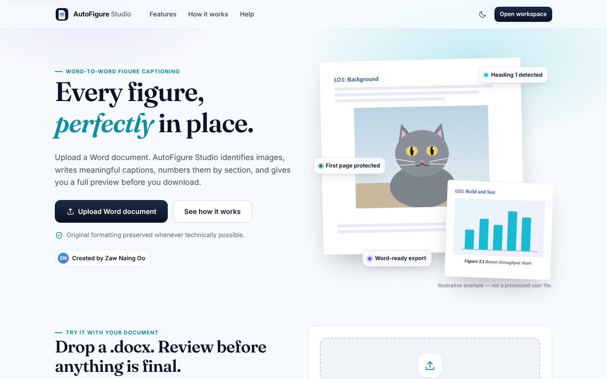
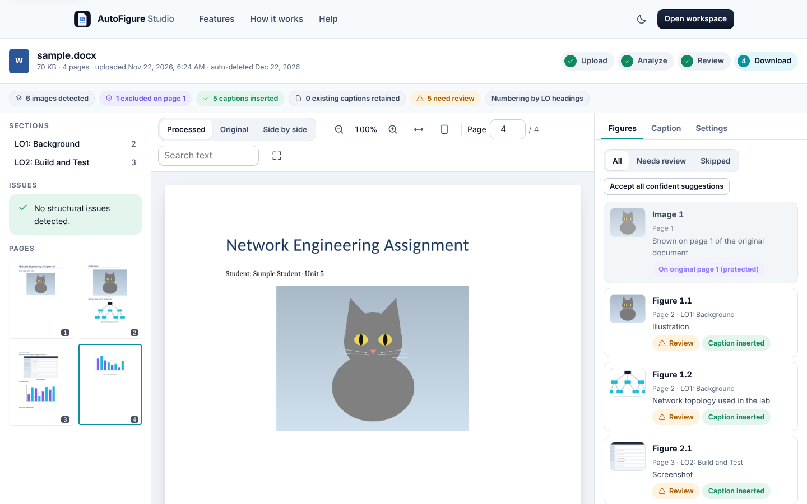
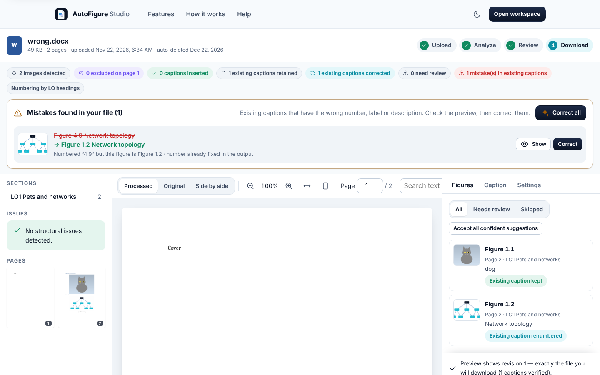
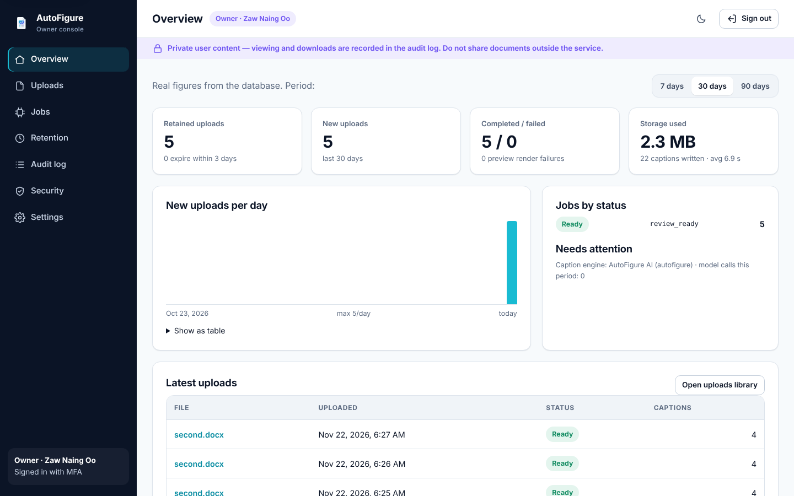

# AutoFigure Studio

**Every figure, perfectly in place.** Upload a Microsoft Word document; AutoFigure Studio finds every picture after the
cover page, numbers captions by Learning Outcome / Heading 1 (Figure 1.1, 1.2 … then 2.1 under LO2), writes
descriptions with **AutoFigure AI**, finds mistakes in captions you already wrote, shows a true preview of the exact
output, and gives you back an editable `.docx`.

Created by **Zaw Naing Oo** — the only person who can enter the private owner console.



| Review workspace | Mistakes found in your file | Owner console |
|---|---|---|
|  |  |  |

More screenshots: [`docs/screenshots/`](docs/screenshots). A real input/output pair produced by the pipeline:
[`docs/samples/sample_input.docx`](docs/samples/sample_input.docx) →
[`docs/samples/sample_input_AutoFigure.docx`](docs/samples/sample_input_AutoFigure.docx)
(cover cat skipped; `Figure 1.1 A cat staring`, `1.2 Network topology used in the lab`, `2.1 Screenshot`,
`2.2 Performance results`, `2.3 Chart comparing latency`).

## Quick start (local)

Requirements: Python 3.11+, LibreOffice (`soffice`), poppler-utils (`pdftoppm`, `pdftotext`, `pdfimages`).

```bash
pip install -r requirements-dev.txt
```

```bash
export AUTOFIGURE_DATA_DIR=./data AUTOFIGURE_OWNER_EMAIL=you@example.com
```

```bash
python -m autofigure check
```

```bash
python -m autofigure serve --with-worker
```

Open http://localhost:8000. **Hosting:** see [`DEPLOY.md`](DEPLOY.md). Vercel cannot run this app; use Render
(`render.yaml`), Railway, Fly.io or a VPS. In production run the web process and `python -m autofigure worker` separately
(see `docker-compose.yml`), behind HTTPS (`deploy/nginx.conf`), with `AUTOFIGURE_SECURE_COOKIES=true`.

### Tests

```bash
python -m pytest -q
```

69 tests: numbering invariants, 16 synthetic Word fixtures through the real renderer, OOXML preservation,
idempotency, validation of hostile files, AutoFigure AI, and end-to-end API/authorization tests including the
spec's acceptance scenarios A–J.

## Owner account (creator only)

1. Set `AUTOFIGURE_OWNER_EMAIL` and run `python -m autofigure owner-invite`. It prints a single-use link valid for
   30 minutes (the token sits in the URL fragment so it never reaches server logs).
2. Open it on the creator's device, set a 14+ character password, scan the QR code with an authenticator app and
   confirm a code. Save the 8 recovery codes.
3. Sign in at `/owner/login` (password **and** authenticator code). The owner area is not linked from public pages.

Exactly one owner row can exist (database `CHECK (id = 1)`); there is no public sign-up for it. Every owner API
call checks a server-side session bound to that principal; downloads, deletions and settings changes need a fresh
authenticator confirmation (10-minute step-up). Sessions idle out after 30 minutes and expire after 12 hours.
Lost device → recovery code; operator recovery → `python -m autofigure owner-reset` then a new invite.
Rotate MFA from **Security**.

## AutoFigure AI

AutoFigure AI is this site's own captioning engine — an orchestration layer, not a new foundation model:

* **AutoFigure Vision (built in, offline, free):** OCR (RapidOCR, models bundled in the pip package) reads the text
  inside each image and pixel analysis detects bar charts, terminals and UI screenshots. Domain rules for coursework
  turn that evidence into grounded captions, e.g. *Network topology with 7 switches and a router*,
  *Output of “show ip route” showing the routing table*, *Screenshot of interface status with VLAN assignments*,
  *Login page with username and password fields*. It never guesses what a photo shows; photos without context are
  flagged for review.
* **Document context:** reads how the author introduced each figure (“The network topology used in the lab is shown
  next.” → *Network topology used in the lab*) and real author alt text. When vision and the author's sentence
  agree, confidence is high; when they disagree the other wording is offered as a second opinion.
* **Vision models (optional):** set `ANTHROPIC_API_KEY` (Claude, default model `claude-opus-5-5`) and/or
  `OPENAI_API_KEY` (ChatGPT, `AUTOFIGURE_OPENAI_MODEL`). With both, captions are cross-checked: agreement raises
  confidence; disagreement is flagged with a one-click “second opinion”.
* **Mistakes in existing captions:** wrong numbers, wrong label format and duplicate numbers are always detected;
  offline, a caption naming the wrong kind of image (“Bar chart …” under a network topology) is caught too. With a vision model, descriptions that don't match the picture (a cat photo captioned “Figure 1.1 dog”) are
  flagged with a proposed fix. **Correct all** rewrites them and regenerates the file; **Keep mine** dismisses.
* Uploaded text is passed to models only as delimited reference data (prompt-injection resistant); outputs are
  schema-validated and sanitised. The privacy page and upload card name exactly which providers receive images.

Offline it cannot describe the *content of photographs* (a cat vs a dog); that needs Claude or ChatGPT. It is not a
model that sees better than them; its strength is cross-checking several grounded sources and flagging disagreement.

Sample from the offline engine: [`docs/samples/coursework_input.docx`](docs/samples/coursework_input.docx) →
[`docs/samples/coursework_input_AutoFigure.docx`](docs/samples/coursework_input_AutoFigure.docx).

## How it works

| Step | What happens | Code |
|---|---|---|
| Validate | extension + magic bytes + OPC structure, macro/encryption/zip-bomb/path/DOCTYPE checks; rejects PDF, images, .doc, .docm | `autofigure/engine/validation.py` |
| Locate | reading-order walk of `w:drawing` / VML pictures (inline, floating, in tables); one figure per displayed occurrence | `engine/locator.py` |
| Page 1 | original rendered by LibreOffice (no network, throw-away profile); invisible marker before each picture in a probe copy finds its page; cross-checked with page count and per-page image counts. Unverifiable → “confirm” | `engine/pagination.py`, `engine/render.py` |
| Sections | Heading 1 by style inheritance / outline level; LO patterns (`LO1`, `LO 2`, `Learning Outcome 3`); fallbacks Heading 1 → bold “LO” text → whole document | `engine/styles.py`, `engine/numbering.py` |
| Number | pure function; resets per LO; “Introduction” before LO1 is unassigned; LO1 split across two headings continues | `engine/numbering.py` |
| Write | Caption-style paragraph directly below (same table cell), `SEQ Figure` field with `\r` restart + cached number, bookmark `_AFG_<id>`, keep-with-next. Always rebuilt from the untouched original → idempotent | `engine/writer.py` |
| Verify | package/CRC, only `document.xml`/`styles.xml`/`settings.xml` may change, same pictures in the same order, every caption exactly once with expected text next to its picture | `engine/verify.py` |
| Preview | the exact output revision rendered to PNG pages + thumbnails; captions located for highlights and search | `engine/process.py` |

Pipeline / jobs: `autofigure/pipeline.py` (state machine), `autofigure/queue.py` (durable leased queue with retries,
backoff, dead-letter, stalled-job recovery). API: `autofigure/api/public.py`, `autofigure/api/owner.py`.

## Storage, retention, deletion

Metadata in SQLite (`autofigure/db.py`); document bytes, page images and thumbnails AES-256-GCM encrypted in a
private object store (`autofigure/storage.py`) with opaque keys — no static route exists to it. Default retention 30
days (owner-configurable); a sweep every 5 minutes deletes expired content. **Delete my files** removes content
immediately and revokes access; minimal metadata and the hash-chained audit log remain.

## Security summary

Guest jobs are bound to an HTTP-only session cookie (unknown and foreign IDs both return the same 404). CSRF
double-submit + Origin checks, strict CSP (`script-src 'self'`), rate limits, `nosniff`, `frame-ancestors 'none'`,
HSTS in production, logs without filenames or document text. Audit log is append-only and hash-chained
(verified on the Audit page).

## Known limitations

* Page mapping uses LibreOffice; Microsoft Word can paginate slightly differently with other fonts. Figures whose
  page can't be verified are held for confirmation rather than guessed.
* Pictures inside text boxes, SmartArt and drawing canvases are listed but not edited automatically (opt-in).
* Legacy `.doc` is rejected (no sandboxed converter configured). Passkeys are not implemented; owner MFA is TOTP.
* Object store is local disk; an S3 backend must implement the same 4 methods. SQLite suits a single host.
* Cross-references in body text (“see Figure 3”) are not rewritten when numbers change — prose is never edited.
* Burmese UI strings are not translated yet (captions support Burmese).
* AI descriptions with Claude/ChatGPT were implemented against the SDKs but not exercised live here (no API keys);
  tests use stand-in models.

Full requirement → code → test → screen mapping: [`docs/RELEASE_REPORT.md`](docs/RELEASE_REPORT.md).
